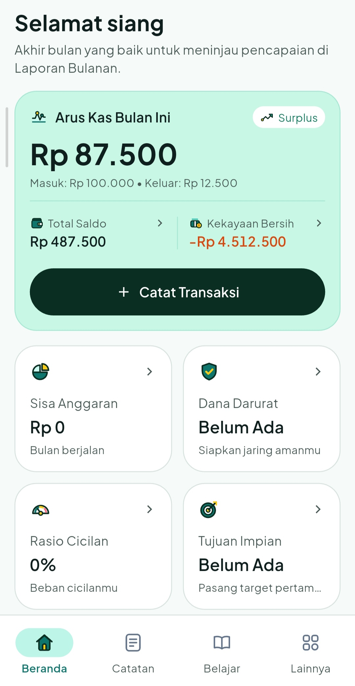
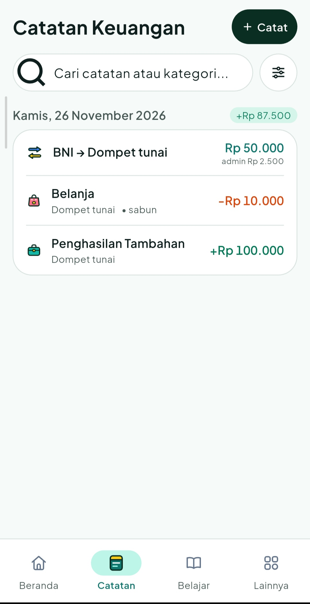
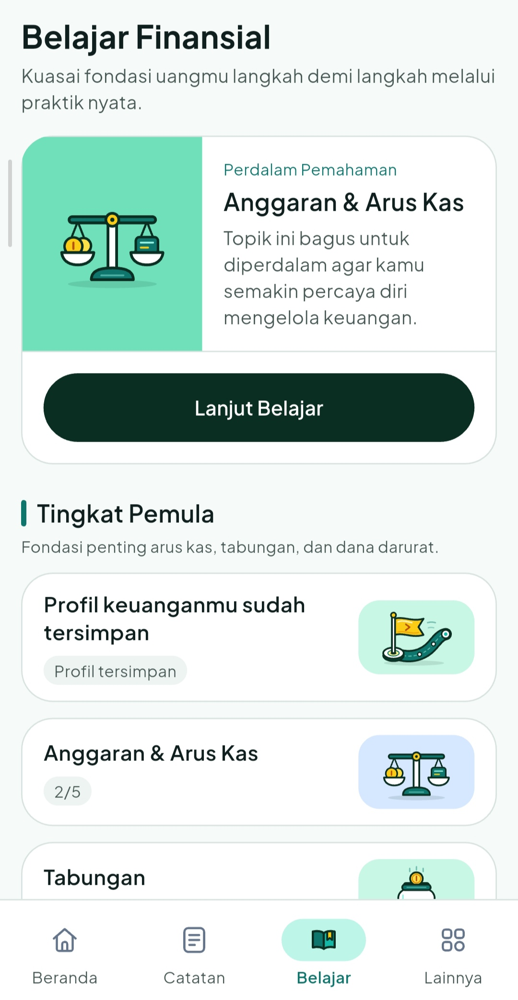
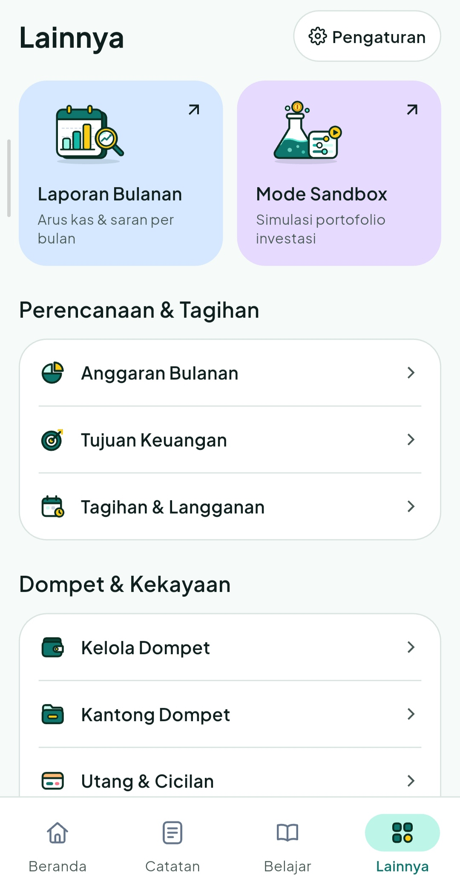

<div align="center">
  
  <h1>Funda</h1>
  <p><strong>Kuasai fondasi uangmu, dari dasar sampai mahir.</strong></p>
  <p>
    Aplikasi keuangan pribadi <em>offline-first</em> berbasis Flutter yang menggabungkan pencatatan arus kas harian,
    18 modul belajar berbasis data riil, dan mode simulasi sandbox.
  </p>

  <p>
    <a href="https://github.com/zidanLPTP/funda/releases/download/v1.2.1/app-arm64-v8a-release.apk">
      
    </a>
    <a href="https://github.com/zidanLPTP/funda/releases/download/v1.2.1/Funda-iOS-unsigned.ipa">
      
    </a>
    <a href="https://github.com/zidanLPTP/funda/releases/tag/v1.2.1">
      
    </a>
  </p>

  <p>
    = 3.38.0" />
    
    
    
  </p>
</div>

---

## Pratinjau Layar

<table>
  <tr>
    <td align="center" width="25%">
      <br />
      <sub><strong>Beranda</strong></sub>
    </td>
    <td align="center" width="25%">
      <br />
      <sub><strong>Catatan</strong></sub>
    </td>
    <td align="center" width="25%">
      <br />
      <sub><strong>Belajar</strong></sub>
    </td>
    <td align="center" width="25%">
      <br />
      <sub><strong>Lainnya</strong></sub>
    </td>
  </tr>
</table>

---

## Unduh Langsung (Android & iOS)

Berkas rilis resmi tersedia di [**GitHub Releases Funda v1.2.1**](https://github.com/zidanLPTP/funda/releases/tag/v1.2.1). Pilih paket sesuai perangkat Anda:

| Platform | Berkas Rilis | Panduan Pemilihan | Unduh Langsung |
| :--- | :--- | :--- | :--- |
| **Android** | `app-arm64-v8a-release.apk` | **Direkomendasikan** untuk mayoritas ponsel Android modern (2017+) | [Unduh APK (arm64-v8a)](https://github.com/zidanLPTP/funda/releases/download/v1.2.1/app-arm64-v8a-release.apk) |
| **Android** | `app-armeabi-v7a-release.apk` | Perangkat Android 32-bit generasi lama | [Unduh APK (armeabi-v7a)](https://github.com/zidanLPTP/funda/releases/download/v1.2.1/app-armeabi-v7a-release.apk) |
| **Android** | `app-x86_64-release.apk` | Emulator Android atau perangkat x86_64 | [Unduh APK (x86_64)](https://github.com/zidanLPTP/funda/releases/download/v1.2.1/app-x86_64-release.apk) |
| **iOS** | `Funda-iOS-unsigned.ipa` | iPhone / iPad (iOS 12.0+, pasang via AltStore / Sideloadly / TrollStore) | [Unduh IPA (iOS)](https://github.com/zidanLPTP/funda/releases/download/v1.2.1/Funda-iOS-unsigned.ipa) |

> **Catatan Pemasangan:**
> - **Android:** Unduh APK yang sesuai (umumnya `arm64-v8a`), buka berkasnya di ponsel, izinkan pemasangan dari sumber tersebut jika diminta sistem, lalu ketuk **Pasang**.
> - **iOS:** Berkas `.ipa` dirilis dalam format *unsigned* (tanpa sertifikat App Store), sehingga pemasangan di iPhone/iPad dilakukan menggunakan alat sideload seperti **AltStore**, **SideStore**, **Sideloadly**, atau **TrollStore**.

---

## Ringkasan Fitur & Nilai Utama

### Pengelolaan
- **Multi-Dompet & Kantong:** Kelola rekening bank, e-wallet, dan tunai, lengkap dengan Kantong untuk memisahkan pos dana darurat atau tabungan.
- **Pencatatan Transaksi & Anggaran:** Catat pemasukan, pengeluaran, transfer antar dompet, serta pantau batas anggaran bulanan per kategori.
- **Tujuan, Utang, & Tagihan:** Lacak progres target tabungan, sisa pokok utang dan rasio cicilan, jadwal tagihan berulang, pengingat lokal, serta kalkulasi kekayaan bersih.
- **Laporan & Ekspor:** Ringkasan komposisi pengeluaran bulanan dengan sakelar sembunyikan nominal dan ekspor ke PDF atau PNG.

### Pembelajaran
- **18 Modul Berjenjang:** Kurikulum Pemula, Menengah, dan Lanjutan mulai dari arus kas, dana darurat, utang, pajak, proteksi, hingga investasi dan usaha kecil.
- **Gerbang Data & Misi Praktik:** Materi terhubung langsung dengan catatan keuangan pengguna untuk menghasilkan umpan balik angka riil, dengan panduan pengisian data langsung saat pelajaran berikutnya masih terkunci.
- **Kamus Keuangan Progresif:** Kumpulan istilah keuangan yang terbuka bertahap mengikuti progres belajar pengguna, lengkap dengan pencarian berdasarkan istilah, arti, maupun contoh Rupiah.
- **Mode Sandbox (Simulasi):** Ruang latihan dengan saldo fiktif yang terisolasi dari pencatatan asli untuk menguji keputusan keuangan tanpa risiko.

### Privasi Offline
- **100% Lokal di Perangkat:** Berjalan tanpa server eksternal, tanpa akun wajib, tanpa iklan, dan tanpa pelacak aktivitas.
- **Cadangan Terverifikasi:** Ekspor dan pemulihan data berbasis JSON dengan validasi checksum SHA-256 serta pengaman data terakhir.
- **Aksesibilitas Teruji:** Target sentuh minimal `48x48dp` pada navigasi sub-layar dan kompatibel dengan skala teks sistem hingga `2.0x`.

---

## Arsitektur, Tech Stack & Optimasi Teknis

| Aspek | Implementasi |
| :--- | :--- |
| **Arsitektur** | **Feature-First MVVM** dengan pemisahan lapisan tampilan, kontroler/provider (`flutter_riverpod`), repositori data, dan fungsi perhitungan murni |
| **Basis Data Lokal** | **Drift (SQLite)** dengan migrasi skema bertingkat, kueri terindeks bebas N+1, dan transaksi atomik |
| **Navigasi & UI** | `go_router` deklaratif, sistem token desain terpusat (`TemaFunda`), serta font lokal *Plus Jakarta Sans* |
| **Sistem Aset SVG 100%** | 123 ikon vektor kustom (`IkonUiFunda` & `AsetIkonFunda`), 64 ilustrasi tematik dinamis & keadaan kosong, serta sumber ikon aplikasi tunggal ([app-icon.svg](app-icon.svg)) |
| **Optimasi Ukuran APK** | Pemecahan build per ABI (`--split-per-abi`) dan *icon font tree-shaking* (mengurangi ukuran font ikon hingga >96%, menghasilkan APK rilis ~24–27 MB) |

---

## Cara Build dari Source Code

Kebutuhan: **Flutter SDK >= 3.38.0**, **Dart SDK >= 3.10.0**, dan **Android SDK API 34+**.

```bash
# 1. Kloning repositori & pasang dependensi
git clone https://github.com/zidanLPTP/funda.git
cd funda
flutter pub get

# 2. Generate kode basis data Drift
dart run build_runner build --delete-conflicting-outputs

# 3. Jalankan aplikasi atau uji coba
flutter run
flutter analyze
flutter test

# 4. Build APK rilis per arsitektur
flutter build apk --release --split-per-abi
```

<details>
<summary>Dokumentasi Teknis & Spesifikasi</summary>

- [docs/spec.md](docs/spec.md) — Spesifikasi lengkap fitur dan arsitektur aplikasi.
- [docs/styleguide.md](docs/styleguide.md) — Token desain editorial, warna, dan pedoman bahasa.
- [docs/format_konten.md](docs/format_konten.md) — Skema JSON kurikulum edukasi dan kamus istilah.
- [docs/format_cadangan.md](docs/format_cadangan.md) — Spesifikasi format cadangan JSON dan checksum SHA-256.
- [docs/panduan_rilis.md](docs/panduan_rilis.md) — Panduan penandatanganan APK/AAB dan checklist uji perangkat.
- [CHANGELOG.md](CHANGELOG.md) — Catatan riwayat perubahan antar versi.

</details>
